# 📚 Sistema de Gestión de Biblioteca (Console App C#)

¡Bienvenido al **Sistema de Gestión de Biblioteca**! Una aplicación de consola desarrollada en C# bajo el paradigma de **programación estructural/procedural**, diseñada siguiendo los lineamientos y especificaciones de la guía **GFPI-F-135 V04** del SENA (Tecnología en Análisis y Desarrollo de Software - ADSO).

---

## 📌 Tabla de Contenidos

1. [Descripción General](#-descripción-general)
2. [Características Principales](#-características-principales)
3. [Arquitectura y Metodología](#-arquitectura-y-metodología)
4. [Estructura del Menú Principal](#-estructura-del-menú-principal)
5. [Evidencia de Ejecución (Capturas de Pantalla)](#-evidencia-de-ejecución-capturas-de-pantalla)

---

## 📖 Descripción General

Este proyecto simula la gestión administrativa de una biblioteca comunitaria o académica. Permite el control de inventario de libros, registro y administración de usuarios, procesamiento de préstamos y devoluciones, consultas avanzadas mediante reportes y la gestión de la persistencia de datos en disco.

El desarrollo prioriza el uso de buenas prácticas en programación procedural (métodos estáticos, paso de parámetros, control estricto de bucles `do-while` y validación de entradas mediante `int.TryParse`), evitando el uso de Programación Orientada a Objetos (POO) según los requerimientos formativos.

---

## ✨ Características Principales

- **Módulo de Libros:** Registrar, listar (todos, disponibles, prestados), actualizar y eliminar libros.
- **Módulo de Usuarios:** Registro, actualización, listado e inactivación de usuarios.
- **Módulo de Préstamos:** Registro de préstamos con verificación de reglas de negocio, detalle por ID, devoluciones y anulación/eliminación bajo restricciones administrativas.
- **Búsqueda y Reportes:** Filtros combinados de libros (título, autor, ID, categoría), búsquedas de usuarios y reportes resumidos/vencidos.
- **Persistencia de Datos:** Simulación/ejecución de guardado, carga y reinicio de datos con validación de confirmación `(S/N)`.
- **Flujo de Salida Limpio:** Salida controlada con prompt de guardado previo y limpieza de interfaz en consola.

---

## 🛠️ Arquitectura y Metodología

- **Lenguaje / Framework:** C# (.NET Core / .NET Console Application)
- **Paradigma:** Programación Procedural / Estructurada (`static methods`, variables locales, flujo de control procedural).
- **Flujo de Trabajo (Git Flow):**
  - `main`: Código de producción y releases estables (`v1.0.0`).
  - `develop`: Integración continua de módulos.
  - `feature/*`: Desarrollos modulares aislados (`feature/books-menu`, `feature/users-menu`, `feature/loans-menu`, `feature/search-reports-menu`, `feature/persistence-menu`, `feature/exit-flow`).

---

## 📸 Evidencia de Ejecución (Capturas de Pantalla)

### 1. Menú Principal
Muestra de la interfaz del menú principal al ejecutar la aplicación.

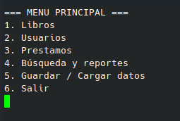

---

### 2. Módulo de Libros y Submenú de Listado
Evidencia de la navegación en el menú de libros (1) y el submenú interactivo para listar libros por estado (1.2).

| Menú de Libros | Submenú Listar Libros (1.2) |
|:---:|:---:|
| 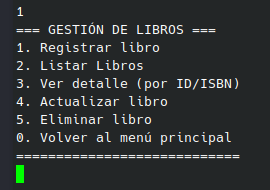 | 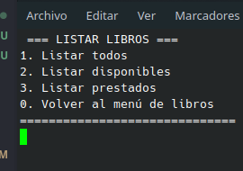 |

---

### 3. Módulo de Usuarios
Navegación e interacciones del módulo de administración de usuarios (2).

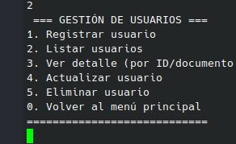

---

### 4. Módulo de Préstamos
Navegación del módulo de préstamos 

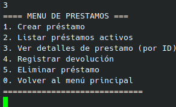

---

### 5. Búsqueda y Reportes
Ejecución de los submenús de búsqueda (4.1, 4.2) y generación de reportes (4.3).

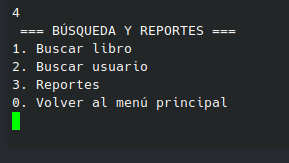

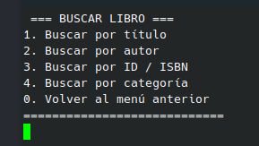

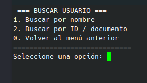

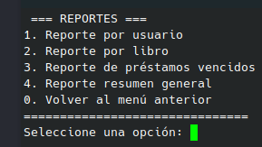

---

### 6. Gestión de Datos y Persistencia
Prueba de confirmación `(S/N)` en el reinicio de datos del sistema (5.3).

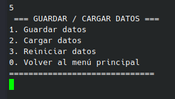

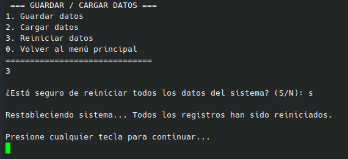

---

### 7. Flujo de Salida Limpio
Evidencia de la opción 6 (Salir) solicitando guardar datos antes de finalizar la sesión y limpiando la terminal.

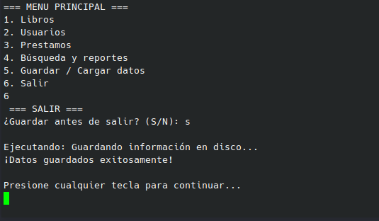